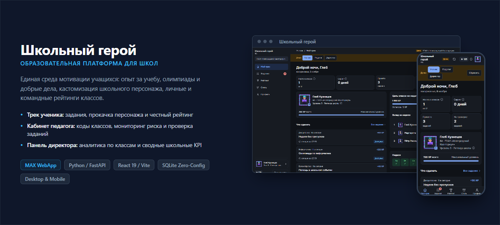

<p align="center">
  
</p>

# Школьный герой

Мини-приложение для MAX. Ученик получает опыт (XP) за задания, олимпиады, кружки и помощь одноклассникам, растёт в уровнях и рейтингах класса и школы. Педагог создаёт задания и подтверждает выполнение, директор регистрирует школу, раздаёт коды классов и видит сводку по школе.

Технологии: Python 3.11+, FastAPI, SQLite; React, TypeScript, Vite. Вход - подписанный `initData` из MAX (HMAC-SHA256).

## Режимы (`APP_MODE`)

| Режим | Назначение | Вход | База |
| --- | --- | --- | --- |
| `prod` (по умолчанию) | боевой сервер; нужен `MAX_BOT_TOKEN` | подписанный `initData` | `school_hero.db` |
| `demo` | витрина с выдуманными данными, только локально | `X-Client-Id`, общий профиль | `school_hero_demo.db` |
| `sandbox` | локальная проверка регистрации школы, база сохраняется между запусками (`npm run sandbox-wipe` стирает), только loopback | `X-Client-Id`, каждый id - отдельный пользователь | `school_hero_sandbox.db` |

Пустой токен режим не переключает: `prod` без `MAX_BOT_TOKEN` не стартует. Подробности: [docs/configuration.md](docs/configuration.md).

## Запуск в Docker

Весь проект собирается в образ (фронтенд, бэкенд, портал), данные лежат в томе. Нужны Docker 24+ и плагин Compose v2.

```bash
cp .env.example .env     # задайте MAX_BOT_TOKEN
docker compose up -d --build
curl http://127.0.0.1:8000/api/health
```

Витрина с выдуманными данными, без токена и без MAX, на <http://127.0.0.1:8001/>:

```bash
docker compose --profile demo up -d --build demo
```

На сервере с nginx и Let's Encrypt: `sudo bash deploy/deploy-docker.sh --domain app.example.org --email you@example.com`. Подробности, резервные копии, обновление и Caddy: [docs/docker.md](docs/docker.md).

## Быстрый старт (локально, без Docker)

```powershell
python -m venv .venv
.\.venv\Scripts\Activate.ps1
pip install -r requirements-dev.txt   # requirements.txt + pytest; на сервере ставится только requirements.txt

cd frontend
npm ci
npm run build
cd ..

Copy-Item .env.example .env     # для показа поставьте APP_MODE=demo
python app.py                   # http://127.0.0.1:8000
```

Проверка регистрации школы без MAX: `npm run sandbox` (после сборки фронтенда), открыть <http://127.0.0.1:8010/>. База сохраняется между запусками; `npm run sandbox-wipe` начинает с пустой.

Тесты:

```powershell
.\.venv\Scripts\python.exe -m pytest tests -q
```

Развёртывание без Docker (systemd + nginx): `sudo bash deploy/deploy.sh --domain app.example.org --email you@example.com`, подробности в [docs/deploy.md](docs/deploy.md).

## Документация

- [docs/screenshots.md](docs/screenshots.md) - скриншоты всех экранов: ученик, гардероб, педагог, директор, мобильная версия
- [docs/architecture.md](docs/architecture.md) - устройство, авторизация, схема БД, права, расчёт XP и рейтингов, ограничения
- [docs/setup-school.md](docs/setup-school.md) - подключение школы: регистрация директора, коды, подтверждение, лимиты
- [docs/roles.md](docs/roles.md) - что делают ученик, педагог, директор, администратор платформы; печать и PDF
- [docs/docker.md](docs/docker.md) - запуск в Docker: compose, профили, деплой с nginx и Caddy, данные, обновление, бот
- [docs/docker-windows.md](docs/docker-windows.md) - Docker на Windows без WSL: Docker Desktop с Hyper-V, команды PowerShell
- [docs/deploy.md](docs/deploy.md) - сервер без Docker: nginx, systemd, сертификат, резервные копии
- [docs/configuration.md](docs/configuration.md) - все переменные окружения, режимы, пути данных
- [docs/bot.md](docs/bot.md) - бот MAX: приветствие и кнопка мини-приложения, webhook, настройка и проверка
- [docs/api.md](docs/api.md) - справочник API
- [docs/development.md](docs/development.md) - разработка, песочница, тесты, соглашения, пределы масштабирования
- [docs/submission.md](docs/submission.md) - сдача работы: состав комплекта, сборка архива и образа (`python tools/package.py`), проверка за 5 минут, ограничения

## Структура

```text
app.py        точка входа FastAPI
backend/      API, логика, база, авторизация
frontend/     React-интерфейс (сборка в static/)
landing/      страница-портал (/portal)
deploy/       deploy.sh, nginx, systemd
docker/       Caddyfile
tools/        list_max_users.py, run_sandbox.py, max_bot.py, package.py (комплект для сдачи)
tests/        pytest
docs/         документация
```
