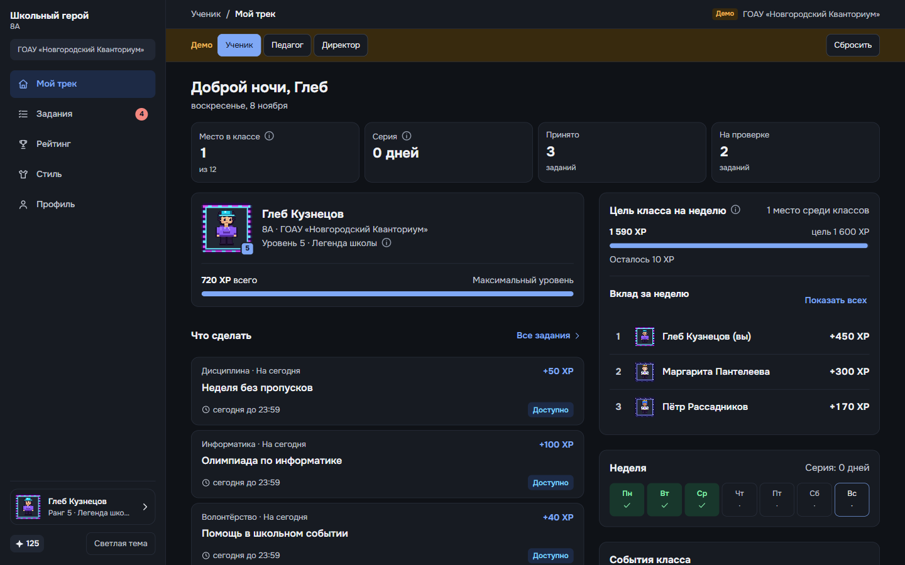
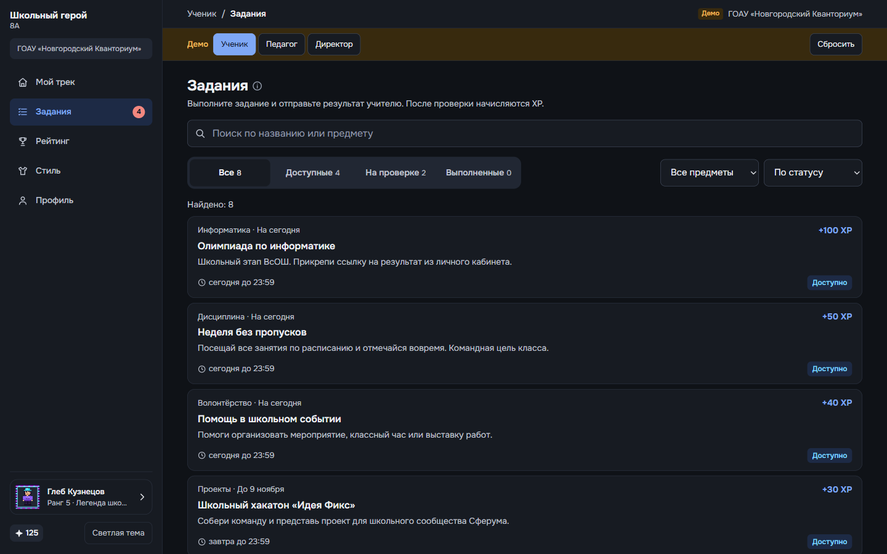
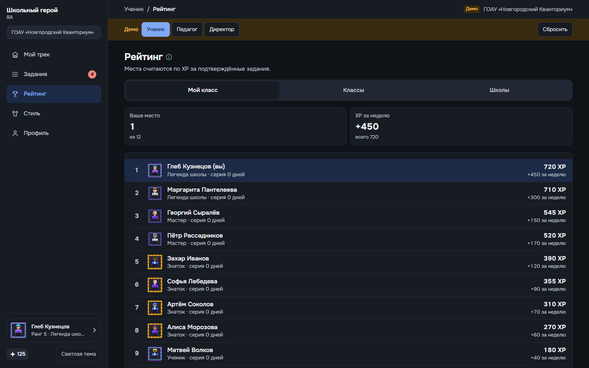
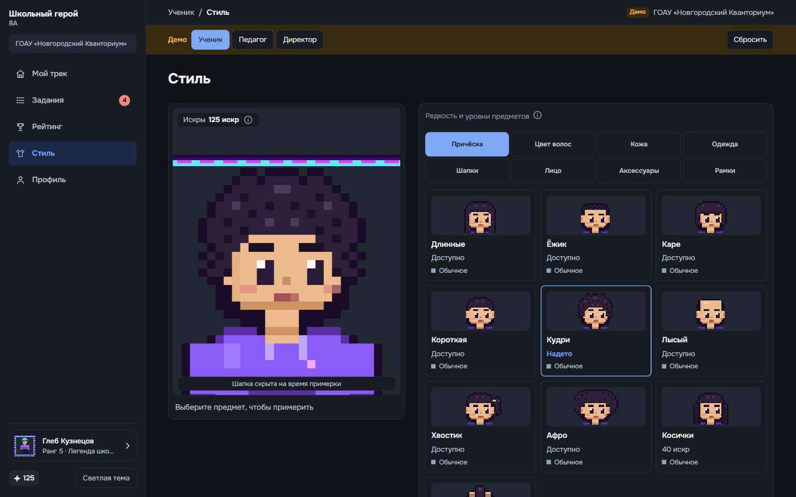
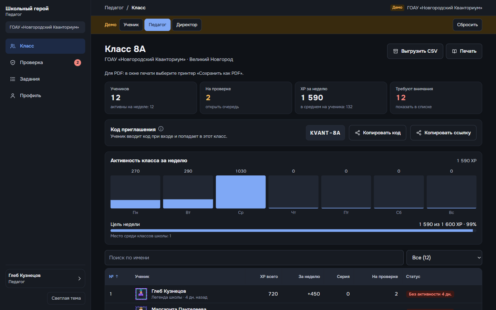
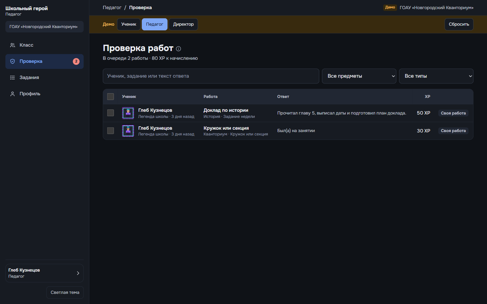
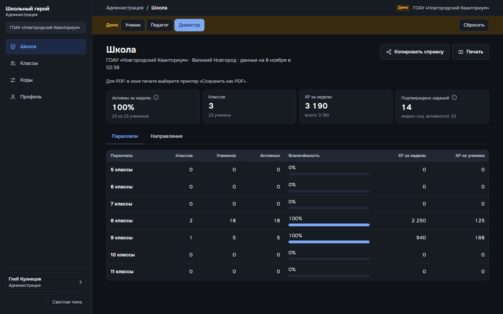
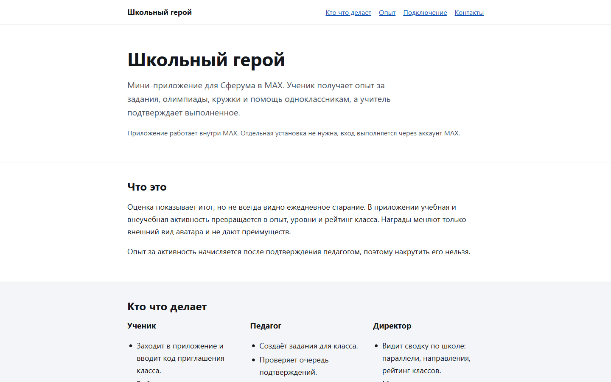
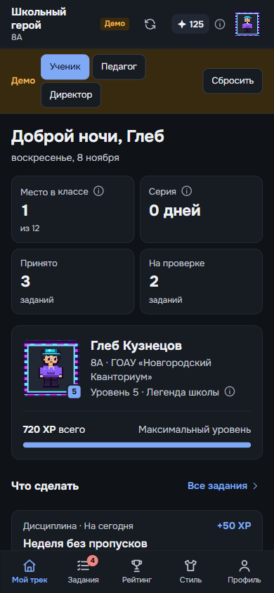
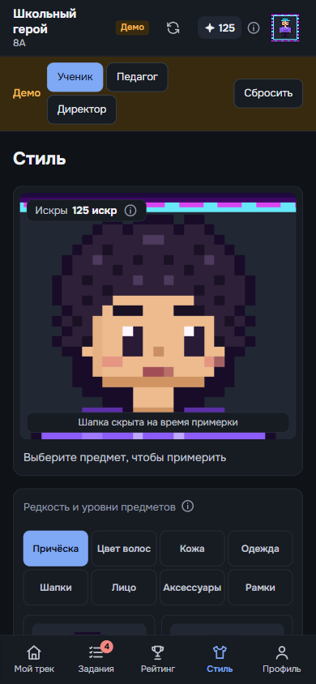

# Скриншоты и интерфейс платформы

Все ключевые разделы платформы спроектированы в строгом, минималистичном образовательном стиле без визуального шума. Поддерживаются полноразмерные десктопные экраны и мобильные устройства (PWA / MAX WebApp).

---

## 1. Ученический трек

### Главный экран ученика
Сводка прогресса, текущий уровень, накопленный опыт (XP), активная серия учебных дней, прогресс дневной цели и ближайшие задания.

### Каталог заданий и активностей
Фильтрация по категориям (учёба, олимпиады, кружки, волонтерство), дедлайны, награды в XP и подача выполненных работ на проверку учителю.

### Честный рейтинг (Класс / Параллель / Школа)
Прозрачная таблица лидеров с переключением масштаба: внутри одного класса, среди классов параллели и по всей школе.

---

## 2. Полноэкранный гардероб персонажа

Студия кастомизации школьного персонажа во весь экран. При выборе категории (причёска, верх, низ, обувь, аксессуары) камера плавно фокусируется на соответствующей зоне персонажа.

---

## 3. Кабинет классного руководителя и педагога

### Управление классом и мониторинг вовлеченности
Отображение кода подключения класса (например, `KVANT-8A`), список учеников, индикация ребят из группы риска (снижение активности/серии) для своевременной поддержки.

### Очередь верификации заданий
Интерфейс быстрой проверки присланных учениками отчётов с подтверждением начисления XP или отправкой на доработку.

---

## 4. Кабинет директора школы и Портал

### Сводная аналитическая панель директора
KPI школы: общее число вовлеченных учеников и классов, охват активностями, активность параллелей и динамика недели.

### Официальный образовательный портал
Презентационная страница для администраций школ и органов управления образованием.

---

## 5. Мобильная адаптация (MAX WebApp / PWA)

Полноценная оптимизация под мобильные экраны смартфонов с нативной нижней панелью навигации (TabBar).

| Главный экран ученика (смартфон) | Мобильный гардероб персонажа |
| :---: | :---: |
|  |  |
